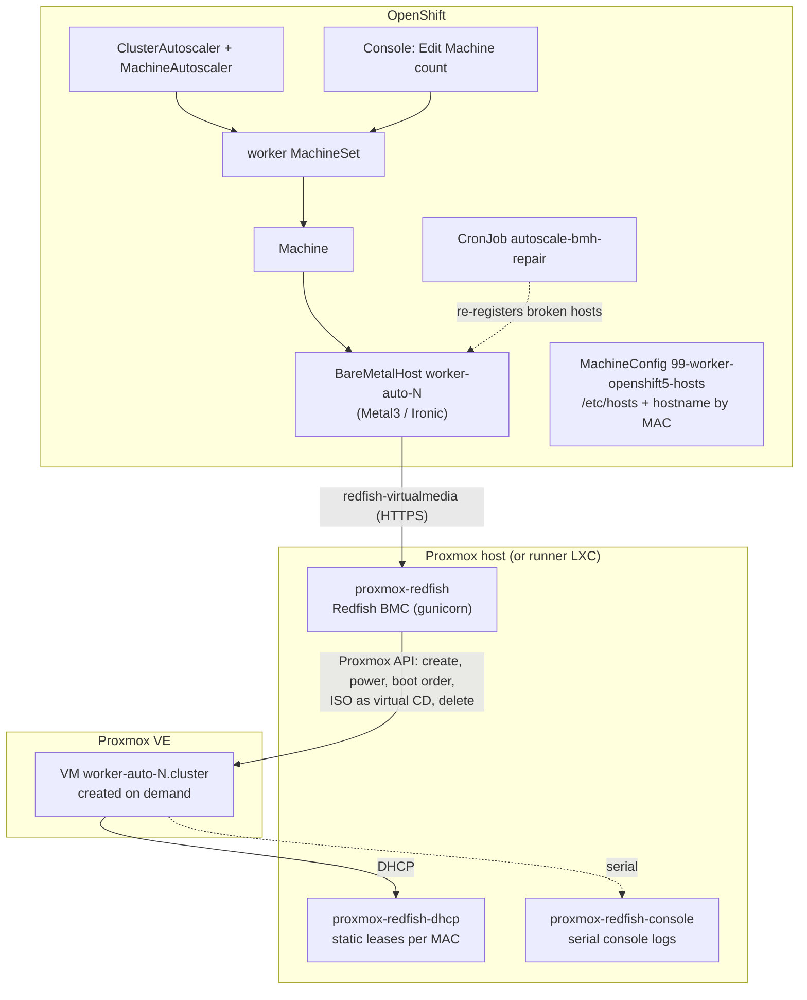
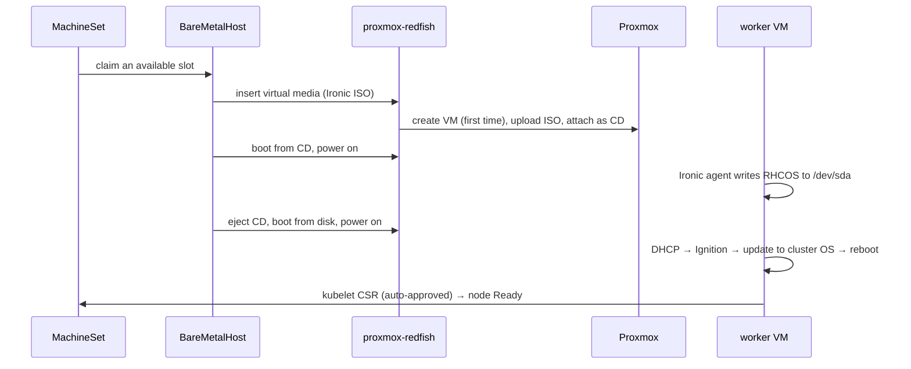

# Autoscaling — how it works

After the install, the worker pool becomes elastic:

- **From the console:** **Compute › MachineSets › _worker MachineSet_ › Edit Machine count**.
- **Automatically:** the ClusterAutoscaler adds workers when pods are
  `Pending` because they fit nowhere, and removes idle workers again.
- **On demand:** a worker VM only exists in Proxmox while OpenShift uses it.

Every step ends up as a call to the Proxmox API.

## Architecture

| Piece | What it does |
|---|---|
| **Metal3** (built into OpenShift with platform `baremetal`) | One `BareMetalHost` per worker slot `worker-auto-0..N`. A slot waits as `available` until the MachineSet claims it; Ironic then installs RHCOS on it. |
| **proxmox-redfish** (`roles/proxmox_redfish`) | A Redfish BMC for Proxmox VMs: the sushy-tools emulator with a Proxmox driver, served by gunicorn on HTTPS with basic auth. Power, boot device, UEFI, virtual CD (downloads Ironic's ISO and uploads it to Proxmox). Only `worker-auto-N.<cluster>` VMs are visible to it. |
| **On-demand VMs** | A slot has no VM. The first command that changes the machine creates it (UEFI, q35, `cpu: host`, fixed MAC, serial port). A reaper deletes the VM once its host is released again. |
| **proxmox-redfish-dhcp** | dnsmasq with static leases for the slot MACs only: fixed IP, hostname, gateway, DNS. Other machines on the network are ignored. |
| **MachineConfig** `99-worker-openshift5-hosts` | Puts all nodes in `/etc/hosts` and gives a new worker its hostname by MAC, so no DNS records are needed. |
| **ClusterAutoscaler + MachineAutoscaler** | Scale the worker MachineSet between `autoscale_min_workers` and `autoscale_max_workers`. |
| **autoscale-bmh-repair** | CronJob that re-registers autoscale hosts stuck in an error state. |
| **proxmox-redfish-console** | Records each worker's serial console to `/var/log/proxmox-redfish/`. |

## Scale-up

About 15–25 minutes from scale-up to a `Ready` node.

## Scale-down

1. The node is drained and the Machine deleted.
2. Ironic deprovisions the host and powers the VM off; the host is
   `available` again.
3. Once the VM has been off for `autoscale_vm_delete_grace` (5 minutes), the
   reaper deletes the VM, its disk and its boot ISO. **No idle VMs in Proxmox.**

Before deleting, the reaper asks the OpenShift API (read-only token) whether the
host is really released. If it can't ask, it deletes nothing.

## Why not the Talos / Cluster API projects?

[talos-proxmox-kaas](https://github.com/kubebn/talos-proxmox-kaas) and
[proxmox-capi-talos](https://github.com/Randsw/proxmox-capi-talos) solve the
same problem for Talos: a Proxmox operator creates VMs, Sidero keeps them as a
pool, and the cluster-autoscaler scales a Cluster API MachineDeployment.

Their code can't drive OpenShift: nodes must be RHCOS configured by the
Machine Config Operator, and OpenShift's Machine API isn't Cluster API. This
project uses OpenShift's own equivalents of the same pattern:

| Talos stack | Shiftmox |
|---|---|
| Proxmox operator | proxmox-redfish (or [kubemox](https://github.com/alperencelik/kubemox)) |
| Sidero server pool | Metal3 BareMetalHosts |
| MachineDeployment | worker MachineSet |
| cluster-autoscaler | OpenShift ClusterAutoscaler |

## kubemox mode

With `autoscale_vm_provisioning: kubemox`, [kubemox](https://github.com/alperencelik/kubemox)
pre-creates every VM up front as a stopped spare pool (`VirtualMachine` CRs in
`proxmox-pool`). Faster scale-up, but VMs sit in Proxmox all the time.
`on_demand` is the default; switching to it removes kubemox VMs that no worker
runs on.
