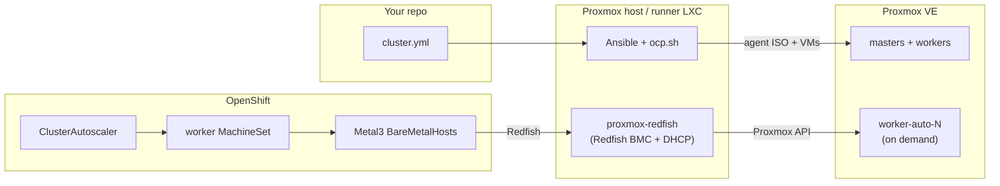

# Shiftmox

**OpenShift / OKD 5 on Proxmox VE, completely from code** — and workers that
scale themselves, straight from the OpenShift console.

The whole cluster is described in one file, `group_vars/all/cluster.yml`.
Ansible builds the agent-based installer ISO, uploads it to Proxmox, creates
the VMs through the Proxmox API and waits until OpenShift is installed. After
the install, one more command makes the worker pool elastic: new worker VMs
are created in Proxmox when they're needed and deleted again when they're not.

-   :material-rocket-launch: **[Quick start](getting-started/quickstart.md)**

    SSH to your Proxmox host, edit one file, run `./ocp.sh deploy`.

-   :material-arrow-expand-horizontal: **[Autoscaling](autoscaling/overview.md)**

    Scale workers from **Compute › MachineSets** or let the ClusterAutoscaler
    do it. VMs are created on demand.

-   :material-github: **[GitHub Actions](deploy/github-actions.md)**

    Deploy and destroy from a workflow, with a self-hosted runner in an LXC.

-   :material-lifebuoy: **[Troubleshooting](troubleshooting.md)**

    `./ocp.sh autoscale-debug` and the problems we already solved.

## Features

| Feature | What you get |
|---|---|
| **Agent-based installer** | No PXE, no bootstrap VM, no external load balancer; VIPs via keepalived inside the cluster |
| **OpenShift or OKD** | One setting: `ocp_distribution: ocp` or `okd` |
| **Any topology** | Single Node OpenShift, compact (3 masters) or standard (3 masters + workers) |
| **Automatic VMs** | Names, VMIDs, IPs, MACs and Proxmox placement are generated from counts and sizes |
| **Calico CNI** | Calico Open Source installed at install time (or OVN-Kubernetes) |
| **Runs on the Proxmox host** | `ocp.sh` installs what it needs, runs in tmux, survives a dropped SSH session |
| **GitHub Actions** | Manual deploy/destroy workflow on a self-hosted runner LXC; lint on every push |
| **Worker autoscaling** | Metal3 + a Redfish BMC for Proxmox: scale from the console, ClusterAutoscaler, VMs on demand |
| **Self-healing** | Broken autoscale hosts are re-registered automatically; leftover VMs are cleaned up |
| **Debuggable** | Serial console logs per worker and a one-command debug report |

## The big picture

!!! warning "Lab and test use"
    Proxmox VE is not a Red Hat certified hypervisor for OpenShift. The
    `none` / `baremetal` agent platforms work, but treat this as a lab or test
    setup.
