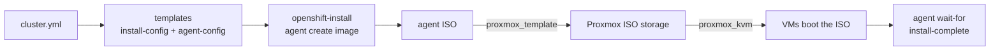

# How it works

## Install flow

1. **Preflight** — Proxmox API and token, node names, DNS records, no DNS
   wildcard.
2. **Tools** — `openshift-install` and `oc` are downloaded and verified against
   the mirror's `sha256sum.txt` (OKD: GitHub releases).
3. **Agent ISO** — `install-config.yaml` and `agent-config.yaml` are rendered
   from `cluster.yml` (static IPs via nmstate, NICs mapped by MAC); for Calico
   the Tigera manifests are added. The ISO is cached unless
   `agent_iso_rebuild=true`.
4. **Upload + VMs** — UEFI, q35, `cpu: host`, virtio-scsi, boot order
   `scsi0` then `ide2`: on first boot the disk is empty so the agent ISO starts;
   afterwards RHCOS boots from disk.
5. **Wait** — `agent wait-for bootstrap-complete`, then `install-complete`;
   prints the console URL and kubeadmin password.

## Notes

- **Name** — the project was called `openshift5` before it became Shiftmox
  (OpenShift + Proxmox). Identifiers that live in your cluster keep the old
  prefix on purpose: the labels `openshift5/role` / `openshift5/cluster`, the
  MachineConfig `99-worker-openshift5-hosts` and the `/etc/hosts` block markers.
  Renaming them would make the playbook lose track of hosts that a worker runs
  on and leave duplicate MachineConfigs behind.

- **Idempotent** — VMs are only created if their VMID doesn't exist; the ISO
  only if missing. Changing the node list of an *installed* cluster isn't
  handled: add workers with [autoscaling](../autoscaling/overview.md),
  `oc adm node-image create`, or rebuild.
- **Install state** lives in `<ocp_state_dir>/<cluster>/build/` (`.work/`
  locally, `/var/lib/ocp-deploy/` in CI). Keep it until install-complete;
  `agent wait-for` needs it. Rendered configs are kept in
  `.work/<cluster>/config/` for review.
- **Mirror path** — `ocp_mirror_base` points at `openshift-v5/...`; check the
  exact path for your version on mirror.openshift.com.
- **Storage** — none is configured. For a lab, LVM Storage (SNO) or the NFS
  subdir provisioner is quickest; ODF needs 3 extra disks per node.
- **Boot image vs cluster OS** — new workers start from the release's boot
  image (e.g. RHCOS 9.8) and update themselves to the cluster OS (e.g. 10.2) on
  first boot, with one reboot.

## Redfish BMC for Proxmox

`roles/proxmox_redfish/files/proxmox_redfish.py` is a system driver for the
OpenStack [sushy-tools](https://docs.openstack.org/sushy-tools/) Redfish
emulator:

| Redfish | Proxmox |
|---|---|
| `Systems` | VMs named `worker-auto-N.<cluster>` + VM-less slots |
| power On / ForceOff / GracefulShutdown / reset | `status/start`, `stop` (overrule-shutdown), `shutdown`, `reset` |
| boot source override | `boot: order=…` |
| boot mode UEFI / Legacy | `bios: ovmf / seabios` |
| VirtualMedia InsertMedia | download ISO → upload to `proxmox_iso_storage` → `ide2` |
| EthernetInterfaces, memory, CPUs, disks | VM config (or the slot definition) |

It runs under gunicorn with one worker process (the VM cache, the list of
just-created VMs and the reaper live in-process) and 8 threads.
